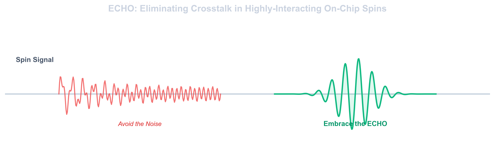

# ECHO

**Avoid the Noise, Embrace the ECHO: Eliminating Crosstalk in Highly-Interacting On-Chip Spins**

ECHO is a Python library for simulating the dynamics and control of interacting quantum spin systems.

The library is designed to support progressively more complex physical models, from simple driven-spin systems to interacting NV-center registers.

## Goals

ECHO aims to provide reusable tools to:

- simulate quantum spin systems with configurable local spin dimension;
- model systems containing an arbitrary number of interacting spins;
- construct and combine different Hamiltonian models;
- implement quantum-control and dynamical-decoupling protocols;
- study spin-spin interactions, crosstalk, and noise;
- perform reproducible simulations through a Python API and a command-line interface.

## Installation

ECHO requires Python 3.9 or newer.

Create and activate a virtual environment:

```bash
python3 -m venv .venv
source .venv/bin/activate
```

Install the library in editable mode:

```bash
python -m pip install --upgrade pip
python -m pip install -e .
```

### Development installation

To install ECHO together with the dependencies required for testing, use:

```bash
python -m pip install -e ".[test]"
```

Run the test suite with:

```bash
pytest
```

### Inspect an NV register

Install the package from the repository root:

```bash
python -m pip install -e .
```

Inspect the provided three-NV configuration:

```bash
echo-register configs/registers/linear/n3/register.json
```

The command outputs JSON containing the site count, laboratory positions
in metres, local-to-laboratory frames, and magnetic fields in tesla.

Alternatively:

```bash
python -m echo_spin.cli configs/registers/linear/n3/register.json
```

Use `echo-register --help` for usage information.

### Inspect an ideal three-NV scenario

From the repository root, inspect the scenario and its control objective:

```bash
echo-register configs/registers/linear/n3/scenario.json --scenario
```

Alternatively:

```bash
python -m echo_spin.cli configs/registers/linear/n3/scenario.json --scenario
```

The JSON report contains:

- resolved positions, local frames, and magnetic fields;
- per-site electronic parameters and explicit units;
- the target pair, logical encoding, gate convention, and spectator objective;
- control assumptions, parameter provenance, and the original specification;
- unresolved settings and limits of the selected model.
- Python and dependency versions, plus the Git revision and working-tree
  status when available.

The initial scenario uses three aligned NV centres in a linear chain
with 15 nm spacing and a uniform 10 mT axial field. The objective is an
entangling gate on sites `(0, 1)` with identity on spectator site `2`.

This command validates and reports the scenario; it does not run gate
evolution or calculate fidelity. Independent instantaneous control is
assumed. Nuclear dynamics, noise, finite-pulse hardware bounds, and
experimental addressability are not assessed.

To save the report:

```bash
python -m echo_spin.cli configs/registers/linear/n3/scenario.json --scenario > /tmp/echo_three_nv_scenario.json
```

The output file is overwritten if it already exists.

Run the focused scenario and CLI tests with:

```bash
python -m pytest tests/test_scenario.py tests/test_cli.py -q
```

No additional dependencies are required.

Scenario validation is independent of register size. Supported environment
records include nitrogen parameters, logical product preparations,
independent local dephasing models, independent scalar uncertainty
distributions, control-design templates, static constraints, numerical
settings, and evaluation requests. Each record is explicitly specified,
unresolved, or not applicable.

The current scenario loader supports the ideal longitudinal model with
instantaneous independent control and no active noise. Recording validated
parameters for future calculations does not activate those calculations.
The report distinguishes parameter validation from physical-model validity
and experimental feasibility.

## Development philosophy

The project is developed progressively. Simple physical models are used first to validate the numerical and software framework before more complex models are introduced.

The same library is intended to support both educational simulations and thesis-related research on interacting NV-center systems.

## Releases

Stable versions of the library are identified using Git tags and releases.

The version submitted for the Software and Computing exam will be explicitly marked as the exam release. Later versions may introduce additional thesis-related models and functionality.

## Status

Early development.