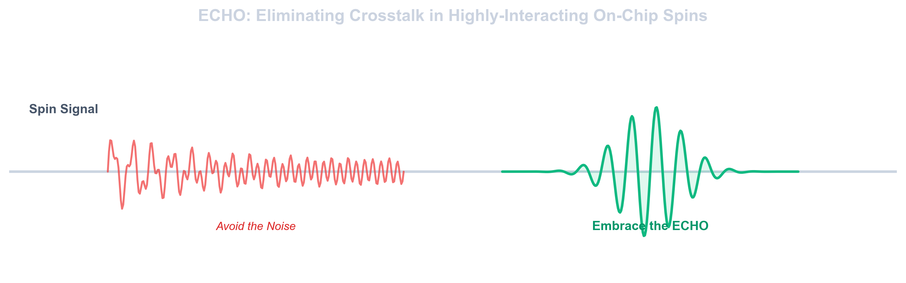

# ECHO

**Avoid the Noise, Embrace the ECHO: Eliminating Crosstalk in Highly-Interacting On-Chip Spins**

ECHO is a Python library for studying dynamical decoupling and selective
entangling gates in interacting NV-centre registers.

The control objective is to retain an interaction between a selected pair
while protecting every spectator. Development proceeds from an ideal
longitudinal qubit model to electronic spin-1 and electron–nitrogen
references with finite microwave pulses.

This is a theoretical simulation project. Its results are conditional on
the stated Hamiltonian, preparation, control assumptions, and parameters;
they are not predictions of a calibrated experimental device.

## Models and scope

| Model or study | Purpose and scope |
|---|---|
| Ideal longitudinal qubits | Design and verify selective interaction retention using instantaneous, independently addressed pulses |
| Finite-pulse qubits | Study drift during pulses, phase cycling, calibration, and control errors |
| Electronic spin-1 reference | Retain the third electronic level and transverse dipolar interactions; assess exchange and leakage |
| Shared microwave control | Include carrier frequencies, polarisation, site-dependent coupling, finite envelopes, and crosstalk within the stated RWA |
| Electron–nitrogen reference | Include intrinsic nitrogen dynamics and compare polarised and unpolarised preparations while retaining nuclear memory throughout a sequence |
| Effective stochastic noise | Explore quasistatic and Ornstein–Uhlenbeck detuning noise, including selected spatial correlations |
| Two-NV Joas reference | Retain the separate detailed reference and its associated analysis tools |

The ideal eight-qubit Hilbert space has dimension 256. The current
full-register electronic and electron–nitrogen reference builders are
limited to small registers, currently up to three NV centres.

These capabilities do not form one fully integrated physical model.
In particular, the current nitrogen and effective-noise gate studies
are separate calculations. General preparation support, isotope support,
and approximation validity depend on the selected model and helper.

Uncalibrated noise strengths and correlation times are sensitivity-study
inputs. They must not be interpreted as measured properties of the register.

## Installation

Python 3.9 or newer is required. Run commands from the repository root.

```bash
python3 -m venv .venv
source .venv/bin/activate
python -m pip install -e ".[test]"
```

The package dependencies are NumPy, SciPy, QuTiP, and Matplotlib.
The `test` extra adds pytest.

For installation without test dependencies:

```bash
python -m pip install -e .
```

## Quick start

### Inspect the register geometry

```bash
echo-register configs/registers/linear/n3/register.json
```

The output reports positions, local frames, and magnetic fields.

### Inspect the ideal scenario

```bash
echo-register configs/registers/linear/n3/ideal/scenario.json --scenario
```

The supplied ideal scenario contains three aligned NV centres in a
linear chain with 15 nm spacing and a uniform 10 mT axial field.
The target pair is `(0, 1)`; site `2` is the spectator.

Scenario inspection validates and reports the specification.
It does not propagate the system or calculate gate fidelity.

The equivalent module invocation is:

```bash
python -m echo_spin.cli \
    configs/registers/linear/n3/ideal/scenario.json --scenario
```

### Export and characterise the ideal scenario

Use a new output directory to preserve existing results:

```bash
mkdir -p results/local_trial

echo-register \
    configs/registers/linear/n3/ideal/scenario.json --scenario \
    > results/local_trial/scenario_report.json

python scripts/registers/ideal/level2_characterise_scenario.py \
    results/local_trial/scenario_report.json \
    results/local_trial/characterisation_report.json
```

Shell redirection overwrites an existing file. The characterisation script
instead rejects an existing output path.

### Plot an existing model comparison

After generating or obtaining the saved comparison report:

```bash
python scripts/registers/comparisons/level6_plot_ideal_physical.py \
    results/linear/n3/comparisons/level_06_evaluation/ideal_physical_comparison.json \
    /tmp/echo_ideal_physical_comparison.pdf
```

This reads saved numerical data; it does not rerun the gate simulation.

Scripts with argument parsers document their options through `--help`.
Some physical trial scripts currently use fixed paths and parameters;
inspect them before running, especially when preserving existing outputs.

## Repository organisation

```text
ECHO/
├── src/echo_spin/             Reusable physics and numerical tools
├── tests/                    Tests organised by functionality
├── configs/
│   ├── registers/            Register and scenario specifications
│   └── joas/                 Existing Joas analysis scripts
├── scripts/registers/
│   ├── ideal/                Ideal longitudinal pipeline
│   ├── physical/             Electronic and nitrogen references
│   ├── comparisons/          Comparisons between models
│   ├── sensitivity/          Control-error and effective-noise studies
│   └── validation/           Approximation and numerical checks
├── results/
│   └── linear/n3/            Organised three-NV studies
└── archive/                  Earlier material outside the active pipeline
```

Core library components include:

- `nv/`: geometry, local frames, magnetic fields, and NV Hamiltonians;
- `control/` and `decoupling/`: pulses, microwave controls, and modulation;
- `dynamics/`: propagators, sequences, and dissipative evolution helpers;
- `spectroscopy/`: transition frequencies and matrix elements;
- `scenario.py` and `characterisation.py`: scenario validation and register characterisation;
- `representation.py`, `protocols.py`, and `implementation.py`: model assembly and control construction;
- `electronic_reference.py` and `nitrogen_reference.py`: detailed small-register references;
- `evaluation.py`, `comparisons.py`, and `plotting.py`: metrics, comparisons, and figures;
- `noise/` and `benchmarks/`: noise models and benchmarking tools.

The presence of a helper does not imply its integration into every
scenario or simulation.

## Simulation pipeline

1. Define the geometry, field, preparation, target, and controls.
2. Characterise transitions, matrix elements, and interactions.
3. Design selective controls using the ideal longitudinal baseline.
4. Implement the controls at the selected physical level.
5. Evaluate the whole-register operation and diagnose errors.
6. Check numerical convergence and relevant approximations.
7. Compare spacing, magnetic-field, preparation, and control choices.
8. Save assumptions and numerical results before generating figures.

The longitudinal model is a control-design baseline. It is not
automatically a validated reduction of the full dipolar Hamiltonian.

Physical comparisons must state compatible target frames, preparations,
and control assumptions.

## Results and reproducibility

Three-NV results are separated by their physical content:

```text
results/linear/n3/
├── ideal/
├── physical/
│   ├── electronic/
│   └── electron_nitrogen/
├── comparisons/
├── sensitivity/
│   ├── finite_qubit_controls/
│   └── effective_noise/
├── validation/
├── README.md
└── migration_manifest.json
```

Numbered level folders retain the pipeline stage within each study.
Figures are stored alongside their numerical reports.

See `results/linear/n3/README.md` for the study index.
The migration manifest maps historical result paths to their current
locations. Existing reports retain their original provenance and may
therefore contain historical paths.

Reports include resolved settings and software provenance where
implemented. Preserve the generating configuration, command, numerical
resolution, and random seed when adding a study.

Earlier scans are retained for traceability. Their presence does not
certify that they are converged or suitable for a thesis conclusion.

## Conventions

- Set `hbar = 1`.
- Express time in microseconds and Hamiltonians in angular-frequency
  units, `rad/us`.
- Use metres for positions, tesla for magnetic fields, and `T/m` for gradients.
- Place logical site `0` on the left of tensor products.
- Use the logical encoding `|0> = |m_s=0>` and
  `|1> = |m_s=-1>` unless a calculation states otherwise.
- Distinguish logical tensor ordering from the physical
  electron–nuclear subsystem ordering recorded by each reference.

The scenario coefficients `gamma_e` and `gamma_n` multiply `B·S` and
`B·I` directly. When importing physical gyromagnetic ratios defined by
`H_Z = -gamma B·J`, negate them and convert to `rad/us/T`.

The helper `sqrt_zz_gate()` returns
`G_plus = diag(1, i, i, 1)`. The detailed Joas reference targets
`G_minus = diag(1, -i, -i, 1)`. These differ by a local `Z ⊗ Z`
operation; they must not be compared as identical gates without
declaring that correction.

Whole-register gate fidelity compares the selected pair operation
with identity on all spectators. It is not an average over sites.
Leakage and any allowed local corrections must be reported separately.

## Testing

Run focused tests for the component being changed:

```bash
python -W error::RuntimeWarning -m pytest \
    tests/test_scenario.py tests/test_cli.py -q
```

For a broader check:

```bash
python -m pytest
```

Numerical convergence checks are separate from unit tests.
Passing tests does not establish the physical validity of a model
or the experimental feasibility of its parameters.

## Development status

ECHO is under active thesis development. Current priorities are:

- consolidate comparisons between ideal, electronic, and nitrogen models;
- improve controls across different nuclear preparations;
- combine nuclear dynamics with justified environmental models;
- assess relevant approximation errors;
- extend geometry and magnetic-field comparisons.

Stable milestones can be identified by Git tags. The Software and
Computing exam version should be explicitly tagged separately from
subsequent thesis development.